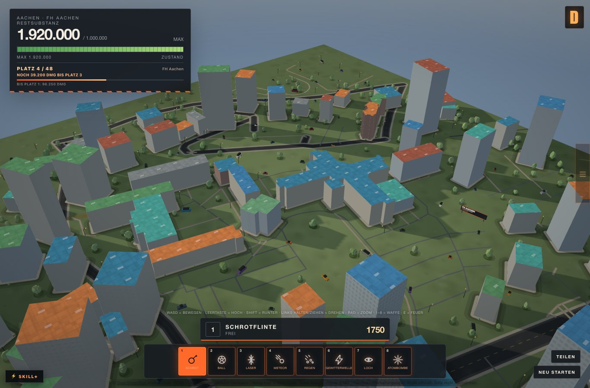
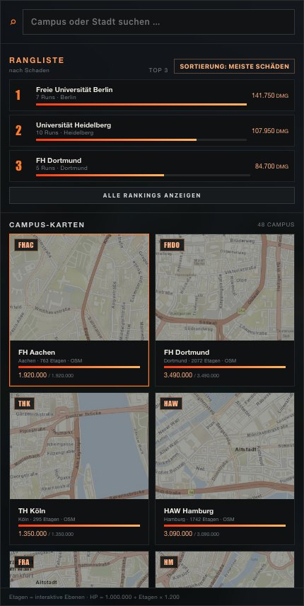

# BENGDA · CAMPUS ABRISS

### Ein 3D-Abriss-Spiel auf echten Campus-Karten.

**48 echte OpenStreetMap-Campusse · Online-Rangliste · Deutsch / 中文 / English**

[Deutsch](#deutsch) · [中文](#中文) · [English](#english)

---

## Screenshots

| Rangliste / Online | Gameplay |
|:---:|:---:|
|  |  |

---

## Deutsch

**BENGDA — Campus Abriss** ist ein kostenloses 3D-Browserspiel: Zerstöre Gebäude auf echten Campus-Karten, sammle Schaden und kämpfe mit deiner Hochschule in der Online-Rangliste.

**Spielen:** https://markszt.github.io/BENGDA-Campus-Abriss-Simulator/

### Funktionen

- **48 Campus-Karten** aus echten OpenStreetMap-Daten
- 19 FH/HAW-Campusse + 29 öffentliche Universitäten
- Standardkarte: **FH Aachen**
- Pro Spiel wird nur **eine** Karte geladen und als 3D-Szene aufgebaut
- Online-Rangliste nach Gesamtschaden
- Ranglisten-Snapshot beim Öffnen; Rang und Abstand zum nächsten Platz werden lokal berechnet
- Schaden wird alle 6 Sekunden sowie beim Verlassen der Seite hochgeladen
- 8 Waffen und Fähigkeiten
- Deutsche, chinesische und englische Oberfläche
- Läuft direkt im Browser, keine Installation

### Schnellstart

1. https://markszt.github.io/BENGDA-Campus-Abriss-Simulator/ öffnen
2. Campus auswählen
3. **SPIELEN** drücken
4. Gebäude zerstören und Schaden sammeln

### Steuerung

| Taste | Funktion |
|---|---|
| W A S D | Bewegen |
| Leertaste | Springen |
| Shift | Rennen |
| Linke Maustaste halten/ziehen | Drehen |
| Mausrad | Zoom |
| 1–8 | Waffe wählen |
| E | Feuer |

### Technik

- Three.js
- OpenStreetMap (ODbL)
- Cloudflare Worker + D1 für die Online-Rangliste
- GitHub Pages für das Hosting

### FAQ

**Warum lädt die erste Karte kurz?**  
Weil beim Start nur die ausgewählte Karte geparst und als 3D-Szene aufgebaut wird.

**Wird die Rangliste jede Sekunde neu geladen?**  
Nein. Beim Öffnen wird ein Snapshot geladen; Rang und Abstand werden danach lokal berechnet.

**Werden meine Punkte beim Schließen gespeichert?**  
Ja, die aktuelle Runde wird beim Verlassen der Seite nach Möglichkeit noch hochgeladen.

### Hinweis

Inoffizielles Fan-Projekt. Keine Verbindung zu den genannten Hochschulen. Alle Campus-Namen und Gebäudedaten dienen nur der Unterhaltung.

---

## 中文

**BENGDA — 校园拆除**是一个免费的 3D 浏览器游戏：在真实校园地图上破坏建筑、累计伤害，并让你的大学参与在线排行榜。

**开始游戏：** https://markszt.github.io/BENGDA-Campus-Abriss-Simulator/

### 功能

- **48 张校园地图**，来自真实 OpenStreetMap 数据
- 19 所 FH/HAW + 29 所公立大学
- 默认地图：**FH Aachen**
- 每次游戏只加载并生成**当前选中的一张**地图
- 按总伤害排名的在线排行榜
- 打开页面时读取一次排行榜快照；排名和距离下一名在本地计算
- 每 6 秒上传一次伤害，退出页面时补传
- 8 种武器和技能
- 德语、中文、英语界面
- 直接在浏览器运行，无需安装

### 快速开始

1. 打开 https://markszt.github.io/BENGDA-Campus-Abriss-Simulator/
2. 选择大学
3. 点击 **SPIELEN**
4. 破坏建筑、累计伤害

### 操作

| 按键 | 功能 |
|---|---|
| W A S D | 移动 |
| 空格 | 跳跃 |
| Shift | 奔跑 |
| 按住/拖动鼠标左键 | 旋转视角 |
| 鼠标滚轮 | 缩放 |
| 1–8 | 选择武器 |
| E | 开火 |

### 技术

- Three.js
- OpenStreetMap（ODbL）
- Cloudflare Worker + D1 在线排行榜
- GitHub Pages 托管

### 常见问题

**为什么第一次进地图会等一下？**  
因为只会解析当前地图，但仍需在本地生成建筑和破坏数据。

**排行榜会一直刷新吗？**  
不会。打开时读取一次快照，之后排名和差距在本地计算。

**退出页面时分数会丢吗？**  
正常情况下会在退出时补传当前伤害。

### 说明

非官方同人项目，与相关高校没有隶属关系。校园名称和建筑数据仅用于娱乐。

---

## English

**BENGDA — Campus Demolition** is a free 3D browser game. Destroy buildings on real OpenStreetMap campus maps, deal damage, and compete for your university on the online leaderboard.

**Play:** https://markszt.github.io/BENGDA-Campus-Abriss-Simulator/

### Features

- 48 real OSM campus maps
- Only the selected map is loaded and rendered
- Online leaderboard by total damage
- Snapshot on load; rank and gap are calculated locally
- Damage upload every 6 seconds and on page exit
- 8 weapons and abilities
- DE / 中文 / EN UI
- Runs directly in the browser

### Quick start

1. Open https://markszt.github.io/BENGDA-Campus-Abriss-Simulator/
2. Choose a campus
3. Press **SPIELEN**
4. Destroy buildings and collect damage

### Controls

`WASD` move · `Space` jump · `Shift` sprint · hold left mouse to rotate · wheel to zoom · `1–8` weapons · `E` fire

### Tech

Three.js · OpenStreetMap ODbL · Cloudflare Worker/D1 · GitHub Pages

Unofficial fan project. Not affiliated with any university.
